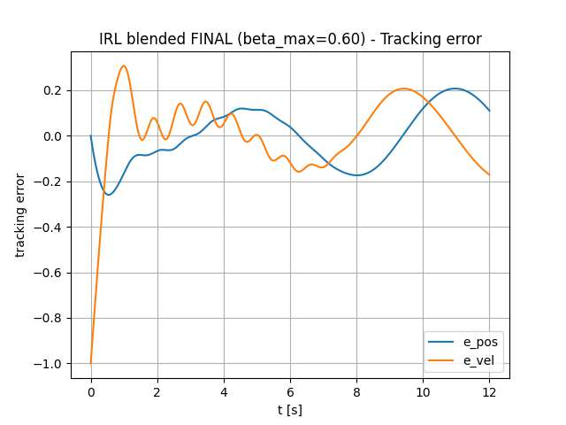

# Integral Reinforcement Learning for Constrained Tracking Control

**A simulation-based comparison of classical PD control, actor–critic Integral Reinforcement Learning (IRL), and blended PD–IRL control for constrained trajectory tracking.**

**Authors:** Mazen Younis · Mert Satici  
**Institution:** Berliner Hochschule für Technik (BHT) · Computer Engineering  
**Course:** Reinforcement Learning  
**Year:** 2026

## Overview

This project investigates whether **Integral Reinforcement Learning (IRL)** can support trajectory tracking in a dynamical system with limited actuator authority. A classical **proportional–derivative (PD) controller** provides a strong reference point; an **actor–critic IRL controller** learns from accumulated tracking costs; and a **blended controller** combines their control actions.

The testbed is a simulated **spring–mass–damper system** following a time-varying reference trajectory. This is a separate control problem from the DC motor speed-control study in the parent repository.

> **Scope:** All evaluations were performed in simulation. The work does not demonstrate deployment, hardware validation, or guaranteed safety of a physical control system.

## Control problem

The plant is a second-order spring–mass–damper system with position $x_1$, velocity $x_2$, and applied force $u$:

$$
\dot{x}_1=x_2
$$

$$
\dot{x}_2=-\frac{k}{m}x_1-\frac{c}{m}x_2+\frac{1}{m}u
$$

The reference position is sinusoidal, and the target state includes its velocity:

$$
x_d(t)=\begin{bmatrix}A\sin(\omega t)\\A\omega\cos(\omega t)\end{bmatrix}
$$

The objective is to minimise **position and velocity tracking errors** while satisfying the hard input limit:

$$
|u(t)|\leq 2
$$

The implementation uses $m=1$, $c=0.5$, $k=2$, $A=1$, and $\omega=1$, with an **RK4 integrator** and a simulation time step of **0.001 s**.

## Controller designs

### 1. Classical PD baseline

The baseline controller uses the tracking error $e=x-x_d$:

$$
u_{\mathrm{PD}}=-K_p e_{\mathrm{pos}}-K_d e_{\mathrm{vel}}
$$

It applies actuator clipping after calculating the control command. The source uses $K_p=10$ and $K_d=4$.

### 2. Integral Reinforcement Learning with actor–critic

The IRL implementation includes:

- **Augmented state:** tracking position/velocity errors and reference position/velocity, forming a four-dimensional input.
- **Critic:** a value-function approximation using a **quadratic polynomial feature basis**.
- **Integral Bellman update:** a short rolling time window approximates the discounted running-cost integral and supplies a critic learning signal.
- **Actor:** a continuous control policy using a **tanh-based saturation** to bound its output.
- **Exploration and warm start:** the standalone IRL experiment initially uses a PD control phase with a decaying sinusoidal exploration signal.

The actor is trained towards a critic-gradient-derived control target, rather than learning a tabular action-value function.

### 3. Blended PD + IRL controller

The blended strategy combines a stabilising PD command with the learned actor command:

$$
u_{\mathrm{blend}}=(1-\beta)u_{\mathrm{PD}}+\beta u_{\mathrm{IRL}}
$$

The implementation gradually increases the mixing factor, caps it at **$\beta_{\max}=0.60$** for the featured experiment, adds a scheduled exploration signal, and clips the applied input to the actuator bounds.

A separate parameter sweep investigates how the allowed IRL contribution changes tracking accuracy. The selected value is a **study-specific compromise**, not a claim that this blend is generally optimal.

## Experimental setup

| Setting | Implementation |
|---|---|
| Plant | Simulated spring–mass–damper system |
| Numerical integration | Fourth-order Runge–Kutta (RK4) |
| Simulation step | 0.001 s |
| Reference trajectory | Sinusoidal position and velocity |
| Actuator bound | $|u|\leq 2$ |
| PD gains | $K_p=10$, $K_d=4$ |
| Critic | Quadratic polynomial features; integral Bellman update |
| Featured blending cap | $\beta_{\max}=0.60$ |
| Evaluation measures | RMS tracking errors, maximum input, Bellman-error magnitude |

## Reported results

The submitted course report provides the following comparison:

| Metric | PD baseline | Blended PD + IRL |
|---|---:|---:|
| RMS position error (last 2 s) | **0.0537** | 0.1781 |
| RMS velocity error (last 2 s) | **0.0772** | 0.1053 |
| Maximum absolute control input | 2.0 | 2.0 |
| Mean Bellman-error magnitude | — | 0.0424 |

**Main finding:** For this well-modelled linear system, **the classical PD controller achieved lower tracking errors** than the blended IRL controller. The blended approach nevertheless demonstrated bounded control and a functioning actor–critic learning procedure in simulation. The result is a useful reminder that adding learning does not automatically improve a strong conventional baseline.

The two reported runs also use **different simulation durations** in the published source (PD: 10 s; blended: 12 s), so their “last 2 s” metrics refer to different time windows. This should be considered when interpreting the comparison.

### Featured visualisation — blended-controller tracking errors



The figure shows the reported position and velocity tracking errors of the blended controller.

**Additional experimental figures:**

- [PD baseline — tracking errors](results/pd_tracking_error.png)
- [IRL — Bellman-error magnitude](results/irl_bellman_error.png)
- **[View all figures and the quantitative comparison](results/README.md)**

## Run the implementation

The project is provided as a single Python source file using **NumPy** and **Matplotlib**. Start in this directory (`constrained-tracking-irl/`) with a recent Python 3 installation.

```bash
python -m pip install numpy matplotlib
```

**Run the classical PD baseline:**

```bash
python main.py run_pd
```

**Run the scheduled actor–critic IRL controller:**

```bash
python main.py run_irl
```

**Run the blended PD + IRL controller ($\beta_{\max}=0.60$):**

```bash
python main.py run_blend
```

**Evaluate different blending limits:**

```bash
python main.py sweep_beta
```

The first three commands print tracking metrics and open Matplotlib plots. The parameter-sweep command prints a comparison table without opening plots.

> **Reproducibility note:** The figures and headline metrics above originate from the **submitted report**, not from a new benchmark carried out specifically for this GitHub README. The report includes additional blending-factor values (such as 0.05 and 0.40); the published `sweep_beta` command currently evaluates **0, 0.1, 0.3, 0.5, 0.6, 0.8, and 1.0**. The code has no bundled pretrained actor/critic checkpoint: each run constructs and trains its controller as part of the simulation. Review the source settings and report before comparing runs.

## Repository files

| File or directory | Description |
|---|---|
| [`main.py`](main.py) | Spring–mass–damper simulation, RK4, PD controller, integral actor–critic, blended controller, logging, and CLI experiments. |
| [`Integral_Reinforcement_Learning_Report.pdf`](Integral_Reinforcement_Learning_Report.pdf) | Full 25-page course report, including mathematical formulation, methodology, figures, numerical results, and limitations. |
| [`results/`](results/README.md) | Selected result figures and the reported PD-versus-IRL comparison. |

## Lessons learned and limitations

- **Baseline comparisons matter.** Learning-based control should be measured against a strong classical controller, not evaluated only by its own training signal.
- **Control constraints matter.** The code explicitly bounds the applied input and studies the effect of blending learned and classical actions.
- **Blending trades off learning authority and tracking precision.** Greater actor contribution did not improve tracking in the reported experiments.
- **The system is intentionally simple.** A low-order polynomial critic and a known linear plant limit how broadly the results generalise.
- **Simulation is not deployment.** Hardware constraints, disturbances, robustness certification, real-time execution, and safe exploration on a physical system were not validated.

Potential extensions include richer function approximators, more uncertain or nonlinear plants, consistent-duration controlled comparisons, and systematic controller validation under additional disturbances.

## Attribution

This project was developed collaboratively by **Mazen Younis** and **Mert Satici** for the **Reinforcement Learning** course at **Berliner Hochschule für Technik (BHT)** in 2026. The implementation and supporting documents are presented as academic engineering work for portfolio purposes.
