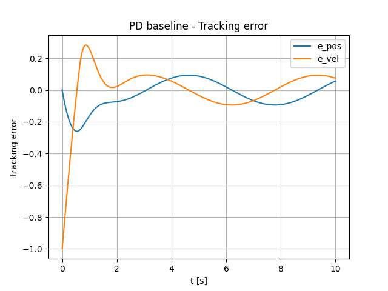
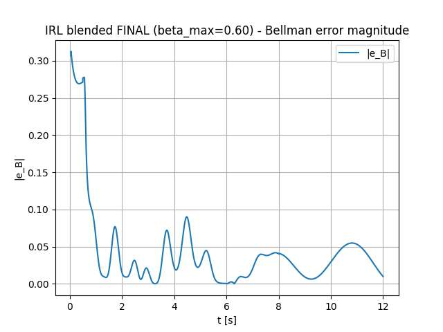

# Integral Reinforcement Learning — Experimental Results

This directory contains selected experimental figures from
the submitted Reinforcement Learning course project.

The project compares classical Proportional-Derivative (PD)
control with an Integral Reinforcement Learning (IRL)
actor–critic controller using a blended control strategy.

## 1. PD Baseline — Tracking Error

Position and velocity tracking errors produced by the
classical PD controller.

The PD controller achieves stable tracking with relatively
small steady-state errors.

## 2. Blended PD + IRL — Tracking Error

Tracking errors produced by the blended PD + IRL controller
with a maximum blending factor of 0.60.

The controller maintains bounded tracking errors while
incorporating the learned actor–critic policy.

## 3. IRL — Bellman Error

Bellman error magnitude during the blended IRL simulation.

The error decreases substantially after the initial
transient, illustrating the learning behaviour of
the critic.

## Quantitative Comparison

| Metric | PD Baseline | Blended PD + IRL |
|---|---:|---:|
| RMS position error (last 2 s) | 0.0537 | 0.1781 |
| RMS velocity error (last 2 s) | 0.0772 | 0.1053 |
| Maximum control input | 2.0 | 2.0 |
| Mean Bellman error | — | 0.0424 |

### Key Finding

The classical PD controller achieved better tracking
accuracy for the simulated second-order system.

The blended PD + IRL controller maintained stable,
constraint-respecting behaviour but did not outperform
the classical baseline.

These results highlight the importance of comparing
learning-based controllers against strong conventional
control methods.

## Source

The figures and metrics originate from the submitted
academic report:

[Integral Reinforcement Learning Report](../Integral_Reinforcement_Learning_Report.pdf)
