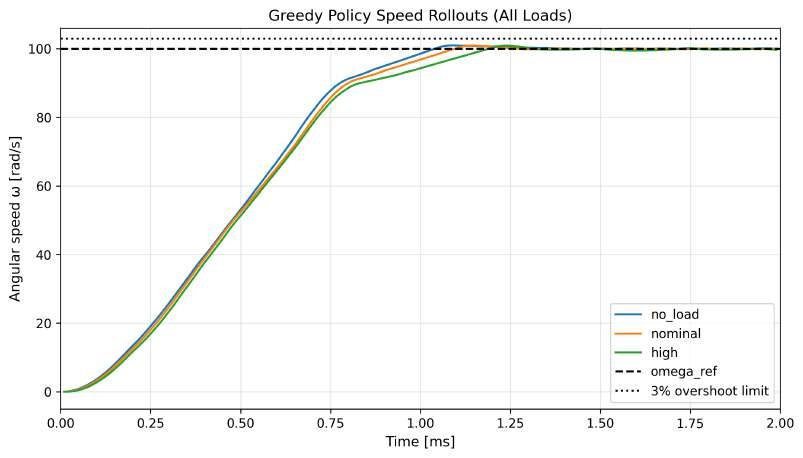

# DC Motor Speed Control with SARSA Reinforcement Learning

**A simulation-based reinforcement learning controller for constrained DC motor speed tracking.**

**Authors:** Mazen Younis · Mert Satici  
**Institution:** Berliner Hochschule für Technik (BHT) · Computer Engineering  
**Year:** 2026  
**Course:** Reinforcement Learning

## Overview

This project explores whether a reinforcement learning (RL) controller can regulate the angular speed of a DC motor while respecting actuator constraints and handling different external loads. A physics-based motor model provides the simulated environment, and a tabular **SARSA(0)** agent learns to choose voltage commands through interaction and reward feedback.

The engineering challenge is not just to reach a target speed, but to reach it quickly, limit overshoot, avoid unnecessarily abrupt control changes, and maintain acceptable performance when the load changes.

> **Scope:** This is a simulation study. The controller was evaluated against a mathematical motor model, not deployed or validated on physical motor hardware.

## Control problem

The simulated motor combines electrical and mechanical dynamics:

$$
L\frac{di}{dt}=V-Ri-K_e\omega
$$

$$
J\frac{d\omega}{dt}=K_ti-b\omega-\tau_{\mathrm{load}}
$$

where $V$ is the commanded armature voltage, $i$ is motor current, $\omega$ is angular speed, and $\tau_{\mathrm{load}}$ represents resisting load torque.

The assignment's main performance requirements are:

- **Target angular speed:** 100 rad/s.
- **Rise time:** reach 90% of the reference in no more than **1 ms**.
- **Overshoot:** no more than **3%**.
- **Voltage:** stay within the **±24 V** actuator limit.
- **Robustness:** evaluate the controller under no-load, nominal-load, and high-load conditions.

## Approach

### 1. DC motor simulation

`main.py` implements the motor's electrical and mechanical response using a discrete-time simulation. Its environment returns motor state information, rewards, episode-termination signals, and diagnostics for plotting and evaluation.

### 2. Tabular SARSA controller

The agent uses **on-policy temporal-difference learning** with an **ε-greedy** exploration strategy. In the uploaded implementation:

- **State representation:** discretized angular speed, tracking error, and motor current.
- **Action space:** nine discrete voltages: −24, −18, −12, −6, 0, 6, 12, 18, and 24 V.
- **Policy:** actions are selected from a learned state–action value table.
- **Learning:** SARSA updates action values from observed reward and the next selected action.

The reward function balances tracking accuracy with control effort and smoothness, and includes penalties for excessive overshoot and inappropriate voltage direction.

### 3. Training and evaluation

The source includes two training modes:

- **Separate-load training:** train an agent independently for each load scenario to inspect learning behaviour.
- **Robust training:** train one agent across randomly selected load scenarios.

The `evaluate_policy` command also includes an **antagonist-guided load-selection** procedure that varies the load conditions encountered during training before evaluating a greedy policy. Its antagonist selects load *scenarios*; it does not choose motor voltages.

## Reported results

The submitted course report evaluates a greedy SARSA policy under three load conditions:

| Load condition | Rise time to 90% | Overshoot | Steady-state error |
|---|---:|---:|---:|
| No load | 0.78 ms | 0.97% | 0.059 rad/s |
| Nominal load | 0.80 ms | 0.94% | −0.087 rad/s |
| High load | 0.84 ms | 0.91% | 0.404 rad/s |

**Interpretation:** In the reported simulations, all three cases met the specified rise-time and overshoot requirements. The higher load caused a modest increase in steady-state error.

**Reproducibility note:** These values are taken from the submitted course report; they are **not presented as results freshly reproduced from the uploaded `main.py`**. The report describes a nominal-load training experiment, whereas the source file also includes separate-load, randomised-load, and antagonist-guided training configurations. Consequently, runs using the current CLI and its defaults may yield different metrics. The report's state formulation also differs from the state representation in the current source. Consult both artifacts when comparing methods and outcomes.

## Experimental Results and Visualisations

Selected experimental figures from the submitted course
report illustrate the learning behaviour and closed-loop
performance of the SARSA controller.

### Speed Tracking Across Different Loads



The graph compares the angular-speed response under
no-load, nominal-load, and high-load conditions.

The reported controller tracks the 100 rad/s reference
while maintaining limited overshoot across the tested
load conditions.

### Additional Results

The following figures provide further insight into the
learning and control behaviour:

- [SARSA Training Progress — 1,000 Episodes](results/training_progress_nominal_1000_episodes.png)
- [Voltage Control Signal — Nominal Load](results/control_signal_nominal_load.png)

**[Explore the complete experimental results gallery →](results/README.md)**

The figures originate from the submitted project report.
They are not presented as independently reproduced
results from the current published implementation.

---

## Run the implementation

The source is a single Python file and does not require any project-relative imports. Use a recent Python 3 version with **NumPy** and **Matplotlib** installed.

From inside `dc-motor-sarsa/`:

```bash
python -m pip install numpy matplotlib
```

**Generate training curves** for the three individual load scenarios:

```bash
python main.py train_many --episodes 600 --mode separate
```

**Train across randomly selected loads:**

```bash
python main.py train_many --episodes 600 --mode robust
```

**Train and evaluate the antagonist-guided greedy policy:**

```bash
python main.py evaluate_policy --train_episodes 1000
```

By default, plots are written to a local `pictures/` folder. For a CLI-only evaluation without saving images, add `--no_save` to the evaluation command.

> **Note:** `evaluate_policy` trains an agent during each invocation; the repository does not provide a pre-trained policy checkpoint. Results can depend on the training configuration and random seed.

## Repository files

| File | Description |
|---|---|
| [`main.py`](main.py) | Motor simulation, SARSA agent, training configurations, evaluation metrics, and visualisation. |
| [`DC_Motor_Speed_Control_Report.pdf`](DC_Motor_Speed_Control_Report.pdf) | Full course report with motor modelling, methodology, training figures, experimental results, and discussion. |

## Key learning points and limitations

- Designing an RL controller requires **both** a realistic environment and a reward that reflects engineering constraints.
- A discrete action set simplifies tabular learning but limits voltage resolution.
- State discretisation is manageable for an educational simulation, but does not scale as readily as function approximation.
- A policy's performance should be evaluated across multiple disturbance conditions, not judged only by its training return.
- Results from a simulated motor are **not** equivalent to hardware safety, real-time, or deployment guarantees.

Potential extensions include continuous-action controllers, broader load disturbances, and comparison with carefully tuned classical PI/PID controllers under identical conditions.

## Attribution

This university project was completed collaboratively by **Mazen Younis and Mert Satici** at **Berliner Hochschule für Technik (BHT)**. The repository presents their academic work for technical portfolio purposes.
