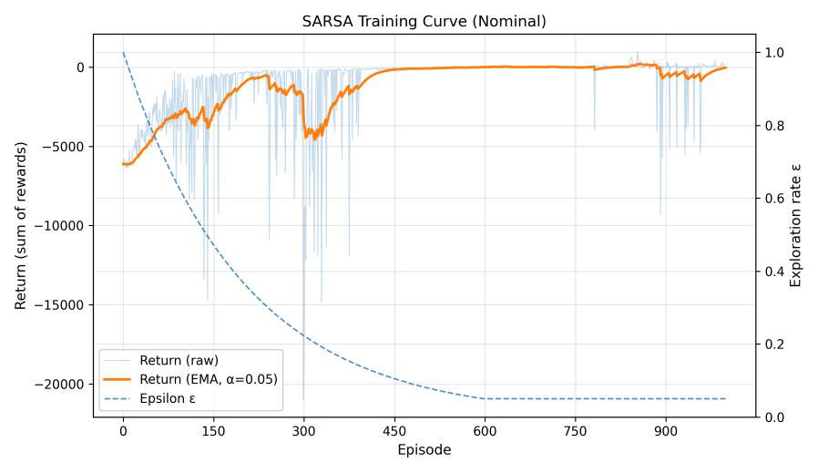
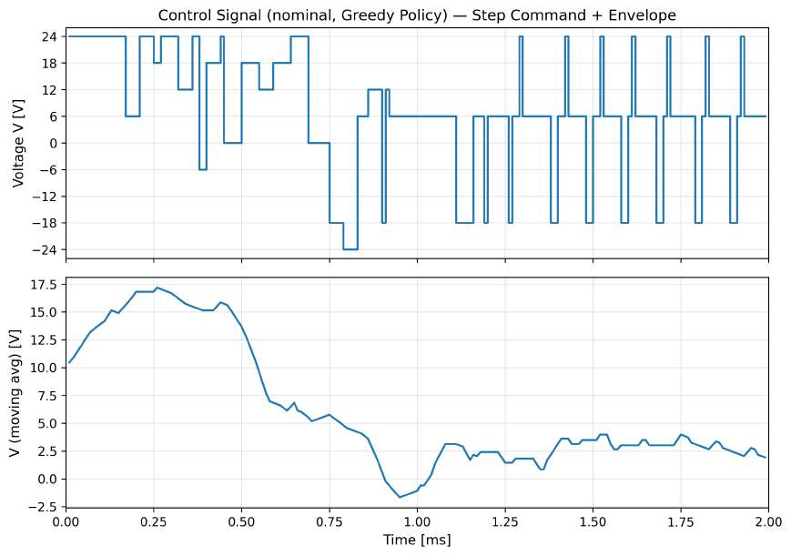

# DC Motor SARSA — Experimental Results

This directory contains selected figures from the submitted
Reinforcement Learning course project.

The figures illustrate the training behaviour, speed-tracking
performance and voltage control actions of the SARSA-based
DC motor controller.

## Speed Tracking Across Loads

The learned policy was evaluated under no-load, nominal-load
and high-load conditions.

## SARSA Training Progress

Training progress under nominal load over 1,000 episodes,
showing episode returns and the exploration schedule.

## Control Signal

Voltage commands generated by the greedy SARSA policy
under nominal-load conditions.

## Source

Figures are taken from the submitted project report:

[DC Motor Speed Control Report](../DC_Motor_Speed_Control_Report.pdf)

These are reported experimental results, not independent
reruns of the currently published source code.
